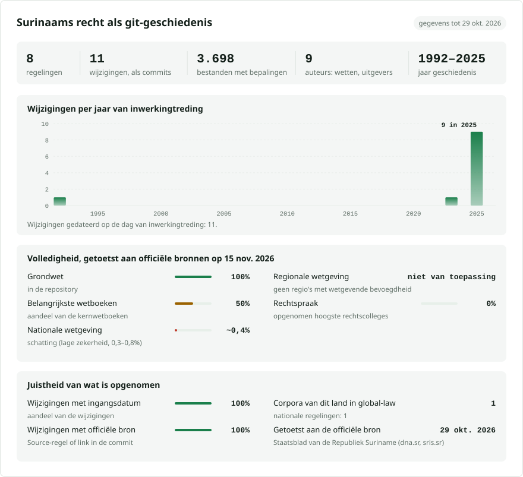

# Suriname: wetsgeschiedenis in git

**Nederlands** · [English](README.en.md)

<picture>
<source media="(prefers-color-scheme: dark)" srcset="data/nl/effort-dark.svg">

</picture>

Het recht van Suriname als git-geschiedenis: één bestand per artikel, één commit per versie op de dag van inwerkingtreding, en als auteur van de commit de wet die de wijziging aanbracht. `git blame` noemt de wet achter elke alinea; `git log` toont elke wijziging van een artikel; wie een datum kiest, krijgt de tekst die op die dag gold.

Onderdeel van [lexifina/global-law](https://github.com/lexifina/global-law), één git-geschiedenis voor het recht van alle landen: dit is het nationale recht van Suriname, dat global-law leest onder `suriname/national/acts/`.

**Wat er nu in staat:** 8 wetten met 11 versies: de Grondwet in 3 versies, van de geconsolideerde tekst van 1992 tot de thans geldende officiële tekst (S.B. 2025 no. 15); het nieuwe Burgerlijk Wetboek (Boeken 1 tot en met 8) en het Wetboek van Burgerlijke Rechtsvordering van 2024, in werking sinds 1 mei 2025; de thans geldende officiële tekst van de Kiesregeling; en vier wetten van 2024-2025 zoals vastgesteld: de Algemene termijnenwet, de Handelsregisterwet, de Wet Kinderombudspersoon en de Wet Spaar- en Stabilisatie Fonds Suriname 2024 (2 versies, de tweede de verbetering ervan bij S.B. 2025 no. 103). [`REPRODUCE.md`](REPRODUCE.md) somt elke wet met haar versies op.

Elke wet is een map, met één bestand per artikel: `grondwet/art-061.md` is artikel 61 van de Grondwet (De Nationale Assemblée en de wijze waarop zij wordt gekozen); het Burgerlijk Wetboek nummert de artikelen per Boek afzonderlijk (`burgerlijk-wetboek/boek-6-art-0162.md` is art. 6:162, het artikel over de onrechtmatige daad). Opschriften worden apart bewaard, in de bestanden `indeling.md`, en de `README.md` van elke map somt alle artikelen op.

De tekst is in het Nederlands, de officiële taal van Suriname, zoals het Staatsblad die afdrukt. Een Engelse vertaling maakt geen deel uit van dit bestand.

## Vragen als git-opdrachten

| Vraag | Opdracht |
| --- | --- |
| Elke wijziging van artikel 61 van de Grondwet | `git log -p --word-diff -- grondwet/art-061.md` |
| Welke wet schreef elke regel van artikel 61? | `git blame grondwet/art-061.md` |
| Elke versie van artikel 61, met de dag waarop elke versie in werking trad | `git log --format="%h %(trailers:key=In-force,valueonly,separator=) %an" -- grondwet/art-061.md` |
| Artikel 61 zoals het gold op 1 januari 2020 | `python tools/geldend_op.py 2020-01-01 grondwet 61` |

**Buiten git** stellen wij dit bestand ook openbaar en gratis beschikbaar:

- **[Vraag Claude naar het Surinaamse recht](https://global-law.lexifina.com/v1/try_claude?country=suriname)**: opent Claude met een eerste vraag klaar.
- **[Vraag het ChatGPT](https://global-law.lexifina.com/v1/try_chatgpt?country=suriname)**: dezelfde vraag in ChatGPT.
- **[Zoek in het Surinaamse recht op onze site](https://lexifina.com/law?country=suriname&q=onrechtmatige+daad)**: een zoekopdracht naar "onrechtmatige daad", met de tekst van elke bepaling en haar versies, zonder account.
- **[REST-API voor ontwikkelaars](https://global-law.lexifina.com/v1/search_law?query=onrechtmatige+daad&jurisdiction=suriname)**: dezelfde zoekopdracht als JSON, zonder sleutel. Zie de [documentatie hier](https://lexifina.com/api/global-law).

Beide assistenten lezen het bestand via de gratis Global law-connector (MCP, `https://global-law.lexifina.com/mcp`); de eerste keer geeft de chat u de link waarmee u die toevoegt. Vraag in het Nederlands of in het Engels.

**Host het eenvoudig zelf.** U hebt alleen git en Python nodig, en de tools draaien op uw eigen computer:

```sh
git clone --depth 1 https://github.com/lexifina/global-law && cd global-law
python3 tools/countries.py add suriname/national/acts
python3 tools/law.py show 2026-01-01 suriname/national/acts/grondwet/art-061.md
```

Geopend in Claude Code, Cursor, VS Code of Codex start de kloon ook een lokale MCP-server met dezelfde tools ([MCP.md](https://github.com/lexifina/global-law/blob/main/MCP.md)).

## Data

Elke commit is gedateerd om 12.00 uur, America/Paramaribo, op de dag waarop de versie in werking trad, en vermeldt die dag in de trailer `In-force:` (de dag van vaststelling en de dag van het Staatsblad staan in `Enacted:` en `Published:`):

- een wet verbindt vanaf haar afkondiging in het Staatsblad, tenzij zij een andere dag bepaalt (Grondwet art. 80 lid 1; Wet Algemene Bepalingen art. 1); de meeste treden de dag daarna in werking, zoals S.B. 2023 no. 157 op 27 oktober 2023;
- de wetboeken van 2024, de Algemene termijnenwet en de Handelsregisterwet traden in werking op 1 mei 2025, de dag die bij Resolutie S.B. 2025 no. 14 werd bepaald;
- de eerste versie van de Grondwet is gedateerd op 8 april 1992, de datum van de wijzigingswet, waarvan het Staatsblad niet online staat, zodat de werkelijke dag enkele dagen later kan liggen; de officiële teksten van de Grondwet en de Kiesregeling die op 7 februari 2025 opnieuw zijn bekendgemaakt (S.B. 2025 nos. 15 en 16), zijn gedateerd op die dag, toen hun tekst verscheen.

Een wijziging wordt alleen aan een wet toegeschreven wanneer de voetnoot van de officiële geconsolideerde tekst die wet noemt ("Gew. bij S.B. 2023 no. 157"), en een wet zoals vastgesteld aan die wet zelf. De oudste beschikbare tekst van de Grondwet en de Kiesregeling, en de 20 verschillen in S.B. 2025 no. 15 die door geen wet worden verklaard (gemarkeerd als "unexplained"), worden toegeschreven aan het Staatsblad. De committer is altijd Lexifina.

## Hoe het wordt gecontroleerd

- `tools/check_repo.py` leest elke versie terug uit git op de dag waarop zij in werking trad en op de dag daarvoor; beide moeten overeenkomen met het corpus waaruit de geschiedenis is opgebouwd. Het controleert ook dat de trailers van elke commit te ontleden zijn, dat er geen merge-commits zijn en dat niets in de toekomst is gedateerd. De resultaten staan in [`REPRODUCE.md`](REPRODUCE.md): 11 versies van 8 wetten, 0 afwijkingen.
- Een tweede opbouw uit hetzelfde corpus gaf identieke commit-hashes.
- Elke tekst komt uit de eigen tekstlaag van een pdf, nooit uit OCR, en van elk woord wetstekst in elke pdf is gecontroleerd dat het in de juiste volgorde in de bestanden staat, behalve opschriften en woorden die over een afbreekstreepje aan het regeleinde heen zijn samengevoegd (voor de wetboeken van 2024 en de latere wetten met een tweede, onafhankelijke extractor).
- De Grondwet van 1992 is vergeleken met twee andere exemplaren (gov.sr en de uitgave op sris.sr met de memorie van toelichting), en de tekst van 2023 met de pagina-afbeeldingen van S.B. 2023 no. 157, een scan; het enige verschil, een komma in art. 161 lid 4, is vastgelegd in `REPRODUCE.md` en niet toegepast.
- [vulnerabilities/](vulnerabilities/): mogelijke redactiefouten in dit recht, gevonden door de detectoren van global-law en met de hand gecontroleerd. Nog niet gedraaid.

## Wat het niet laat zien

- **De Grondwet van 1987 zoals vastgesteld, en de wijziging van 1992 als wijziging.** S.B. 1987 no. 116 noch S.B. 1992 no. 38 staat online in enig gevonden officieel exemplaar, zodat de geschiedenis begint met de geconsolideerde tekst van 1992.
- **Het Wetboek van Strafrecht, en het oude Burgerlijk Wetboek en Wetboek van Burgerlijke Rechtsvordering vóór 2025.** Hun latere wijzigingswetten staan niet allemaal online met een tekstlaag (de meeste zijn scans), en dit bestand gebruikt geen OCR; Boek 7A van het nieuwe Burgerlijk Wetboek, dat op het oude wetboek zou moeten worden opgebouwd, is ook weggelaten.
- **Eerdere versies van de Kiesregeling.** De wijzigingswetten van 2019 en 2023 zijn scans, en die van 2024 en 2025 geven alleen hun wijzigingen.
- **Andere wetten.** Wetten op sris.sr waarvan de pdf's alleen de tekstlaag van een scanner hebben (zoals de Comptabiliteitswet 2024), zijn niet opgebouwd; rechterlijke uitspraken en wetsontwerpen staan er niet in.
- **Voetnoten en de memorie van toelichting** staan niet in de tekst; de voetnoten worden alleen gebruikt om wijzigingen aan wetten toe te schrijven.

## Bronnen

| Bron | Soort | Eerdere versies | Opmerkingen |
| --- | --- | --- | --- |
| [De Nationale Assemblée, Surinaamse wetten](https://www.dna.sr/wetgeving/surinaamse-wetten/) | Officiële wetgeving | geconsolideerde teksten tot 2005, daarna Staatsbladen | De geconsolideerde tekst van de Grondwet van 1992 en S.B. 2023 no. 157 |
| [Surinaams Rechtsinformatiesysteem](https://www.sris.sr/) | Officiële Staatsbladteksten | zoals bekendgemaakt | De thans geldende Grondwet en Kiesregeling, de wetboeken van 2024 en de vier wetten van 2024-2025 |
| [Regering van de Republiek Suriname](https://gov.sr/) | Officieel exemplaar | nee | Een exemplaar van de geconsolideerde tekst van 1992, alleen gebruikt ter controle |

## Licentie

Zie [`LICENSE`](LICENSE). De teksten zijn officiële teksten van de Republiek Suriname, bekendgemaakt in het Staatsblad en gelezen van De Nationale Assemblée en sris.sr; geen van beide publiceert een licentie, hun auteursrechtelijke status is niet bevestigd, en zij worden met die bronvermelding overgenomen. De geschiedenis, commitberichten, tabellen en tools vallen onder CC0 1.0.

Geen enkel AI-model heeft wetstekst geschreven, vertaald of verbeterd, en geen enkel model draait bij het opbouwen van de geschiedenis; de scripts zijn geschreven door een AI-model, dat ook de pagina-afbeeldingen van S.B. 2023 no. 157 heeft bekeken om de tekst ervan te vergelijken (zie [`REPRODUCE.md`](REPRODUCE.md)).

Dit is een vertaling van de Engelse versie ([README.en.md](README.en.md)); bij verschillen geldt de Engelse versie.

## Visualisaties

- [visualisations/](visualisations/): grafieken getekend uit deze repository. Nog niet getekend.

## Meer

Uit de repository [lexifina/global-law](https://github.com/lexifina/global-law) (in het Engels):

- [FEATURES.md](https://github.com/lexifina/global-law/blob/main/FEATURES.md): alle functies en wat elk corpus moet ondersteunen (`git blame`, `law.py`, MCP-tools)
- [FAQ.md](https://github.com/lexifina/global-law/blob/main/FAQ.md): vragen en antwoorden · [CONTRIBUTING.md](https://github.com/lexifina/global-law/blob/main/CONTRIBUTING.md): wijzigingen voorstellen · [MCP.md](https://github.com/lexifina/global-law/blob/main/MCP.md): MCP-server · [REPRODUCE.md](https://github.com/lexifina/global-law/blob/main/REPRODUCE.md): hoe het is gemaakt · [CHANGELOG.md](https://github.com/lexifina/global-law/blob/main/CHANGELOG.md)
- [FRESHNESS.md](https://github.com/lexifina/global-law/blob/main/FRESHNESS.md): hoe actueel elk corpus is · [Monitoring](https://github.com/lexifina/global-law/tree/main/monitoring): of de updates werken · [WATCHING.md](https://github.com/lexifina/global-law/blob/main/WATCHING.md): hoe elke officiële bron op wijzigingen wordt gevolgd
- [performance/](https://github.com/lexifina/global-law/tree/main/performance): hoe snel de tools zijn, gemeten
- [visualisations/](https://github.com/lexifina/global-law/tree/main/visualisations): grafieken en verbanden in het recht van de hele wereld
- [Kwetsbaarheden](https://github.com/lexifina/global-law/tree/main/vulnerabilities): fouten in regelingen zoals ze zijn gepubliceerd
